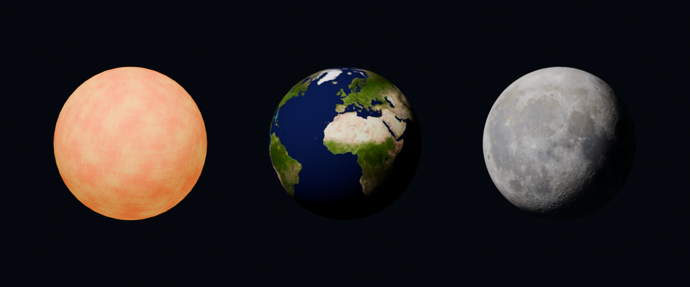

# Third-person celestial models

Created with Blender 5.3.0 through MCP for Blender on 2026-11-14 for the
user-requested asset task. Branch: `feat/celestial-body-models`.

## Deliverables

Each GLB is independent and includes its textures. Only these runtime files
belong in the web build; source maps and scripts remain in `assets/`.

| File in `public/models/celestial/` | Bytes | MiB | Triangles | Textures |
| --- | ---: | ---: | ---: | --- |
| `sun.glb` | 103,796 | 0.099 | 2,208 | 512 × 256 color/emission |
| `earth.glb` | 181,488 | 0.173 | 2,208 | 1024 × 512 color |
| `moon.glb` | 1,180,376 | 1.126 | 16,128 | 2048 × 1024 color; 1440 × 720 normal |

The Moon is 916,776 bytes below the strict 2 MiB (2,097,152 byte) limit.
Each asset has one mesh, one material and one primitive: one ordinary draw
call per body, excluding any additional passes requested by the application.
Textures are embedded JPEGs, quality 92. No Draco, Meshopt, KTX2, external
texture requests, animations, cameras, lights or required glTF extensions.

The Moon's two decoded RGBA8 textures would use approximately 15.94 MiB
including a full mip chain. This is a texture allocation estimate, not a
measured GPU memory or frame-rate result. GLB transfer size is not GPU size.

The review image uses equal display radii and artistic lighting, not physical
relative sizes or ephemeris illumination.

## Coordinate and integration contract

- All bodies are centered at the origin, with reference radius 1. Scale the
  complete imported glTF scene to the desired application radius.
- The Moon's reference radius represents 1737.4 km; its coarse relief changes
  the actual vertex radius to approximately 0.99555–1.00511.
- In the effective glTF scene frame, +Y is north, +X is latitude 0 / longitude
  0, and -Z is latitude 0 / 90 degrees east. Blender source axes are +Z north,
  +X longitude 0, +Y 90 degrees east. Preserve the exported root transform.
- UVs are equirectangular: u=0/1 is the antimeridian, u=0.5 is longitude 0,
  and Blender v=1 is north. The glTF exporter handles the texture-V conversion.
- Load from `/models/celestial/sun.glb`, `/models/celestial/earth.glb` and
  `/models/celestial/moon.glb` using the existing Three.js/R3F loader.
- Earth and Moon need scene lighting. Sun has an emissive material; bloom is
  optional and is not included. These assets do not emit a Three.js light.
- The models contain no time-dependent rotation, libration, phase, position,
  angular size or physical relative scale. The application must set them.

### App integration (`feat/celestial-models-apollo-flag`)

`src/features/scene/CelestialModel.tsx` loads the three GLBs in the
third-person views; the plain spheres remain as the loading fallback.

- Real scale: the Moon is scaled to 1737.4 km and oriented by
  `celestialOrientation.ts` so the selected site lies under the observer, with
  the model north pole along the drawn spin axis (no libration). Its coarse
  relief is shown as-is; the observer and horizon plane stay on the reference
  sphere, so the globe surface can sit a few kilometres above or below them.
- Sun and Earth (both scales): scaled to the radius each view already drew,
  with their model north pole along the lunar spin axis. This orientation is
  illustrative; Earth and Sun rotation are not computed. The Sun material is
  drawn outside tone mapping; the Earth keeps the former sphere's faint blue
  self-glow so a mostly ocean or night-side disc stays findable.
- Visual scale does not draw the Moon (the green disc is the local horizon).
- Checked in the browser on Apollo 11: the three models load and render; no
  device frame-rate measurement was made.

## Sources, attribution and method

Source files are preserved in `sources/`; SHA-256 hashes are in
`build-report.json`. Sources were retrieved on 2026-11-14.

### Moon

Source page: [NASA SVS CGI Moon Kit, ID 4720](https://svs.gsfc.nasa.gov/4720/).
Credit: NASA's Scientific Visualization Studio; visualizer Ernie Wright;
LRO / LROC and LOLA instrument teams.

- [lroc_color_2k.jpg](https://svs.gsfc.nasa.gov/vis/a000000/a004700/a004720/lroc_color_2k.jpg):
  2048 × 1024 preview of the December 2025 color map, centered at 0 degrees.
- [ldem_4.tif](https://svs.gsfc.nasa.gov/vis/a000000/a004700/a004720/ldem_4.tif):
  1440 × 720 floating-point LOLA elevation, 4 pixels per degree, heights in
  kilometers relative to a 1737.4 km sphere. NASA identifies this elevation
  product as based on its spring 2019 gridded data.

`build_models.py` samples the elevation bilinearly on a 128 × 64 UV sphere,
using radius `1 + elevationKm / 1737.4`. A tangent-space normal texture uses
east/north finite differences divided by the corresponding spherical arc
lengths. Longitude wraps; latitude clamps; the last two polar normal-map rows
are flattened because longitude becomes singular. Mesh pole radii use the
mean of the corresponding source row. No synthetic craters or exaggerated
height multiplier are added. Normal shading overlays the coarse geometry
for visual detail; it is not a validated reconstruction of terrain normals.

NASA explicitly describes the color map as optimized for aesthetics, with
adjusted exposure/white balance, filled polar regions and some inpainted
dropouts. The reduced mesh, compressed normals and appearance texture are
for a globe view, not for local slopes, landing suitability, visibility,
communications, energy estimates or scientific measurements.

### Earth

Source page: [NASA SVS Blue Marble, ID 2915](https://svs.gsfc.nasa.gov/2915/).
Texture: [bluemarble-1024.png](https://svs.gsfc.nasa.gov/vis/a000000/a002900/a002915/bluemarble-1024.png).
Credit: NASA/Goddard Space Flight Center Scientific Visualization Studio;
the page also credits Reto Stockli and NASA's Earth Observatory.
The source is a historical composite with baked topographic appearance,
not a view of current weather or surface conditions. Mapped to a smooth
48 × 24 sphere; no separate clouds, atmosphere shell or normal texture.

### Sun

Original procedural artistic texture generated from seeded, seamless 3D
noise on a 48 × 24 sphere. Warm colors and granulation are illustrative;
this is not solar observation data or a scientific photosphere simulation.

### Usage

Retain the NASA credits above when redistributing these derived assets.
See [NASA Images and Media Guidelines](https://www.nasa.gov/nasa-brand-center/images-and-media/).
NASA credit does not imply endorsement. The project-wide software license
remains a separate team decision; this task does not assign one.

## Rebuild and validation

Run `build_models.py` in Blender, with `__file__` set to its absolute path,
or use `blender --background --python <absolute-path-to-build_models.py>`.
It uses Blender's bundled NumPy and the checked-in sources. It creates new
isolated scenes and restores the previous active scene without deleting it.
Repeated runs create additional scenes; exported display names and hashes
can change because Blender adds unique name suffixes.

Run `verify_models.py` the same way to reimport the actual GLBs into a new
review scene, write `validation.json` and render `preview.png`. The review
scene remains active. Generated texture intermediates are in `generated/`.

Observed validation:

- All three files are strictly below 2 MiB, standalone glTF 2 binaries with
  one mesh/material/node each and no external dependencies.
- All three reimport into Blender with decoded embedded textures. Moon's
  normal map and Sun's emission map are present.
- Faces point outward and triangles have nonzero area.
- Rendered the reimported files and visually inspected the review image.
- `npm run build` passed (TypeScript + Vite).
- Browser rendering and mobile frame rate have not been measured. Run that
  check when these assets are connected to the app, especially on mobile.

## Review and proposed project status

Integrator/Andres should review the preview, axis contract and budgets before
connecting the GLBs to the third-person view. Diego should review any later
scientific use; these models do not change existing scientific methods.

Proposed `ESTADO.md` update: three separate third-person celestial GLBs are
prepared and size/reimport/build checks passed; UI integration and device
performance review remain pending.

Proposed `DECISIONES.md` entry: user requested separate Sun/Earth/Moon models,
with greater lunar visual detail and a strict Moon GLB limit below 2 MiB.
The asset task does not establish new scientific accuracy guarantees.

`GIT_WORKFLOW.md` was not present in this checkout. Existing `AGENTS.md`
branch/review rules were followed. No commit, push, PR or merge was made.
